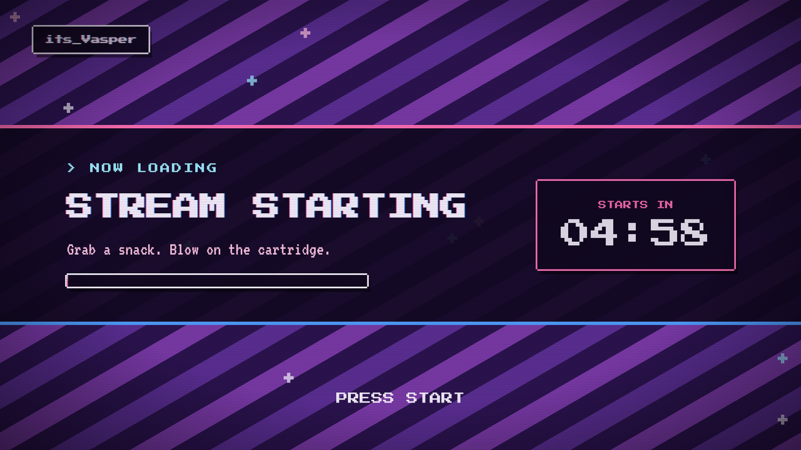
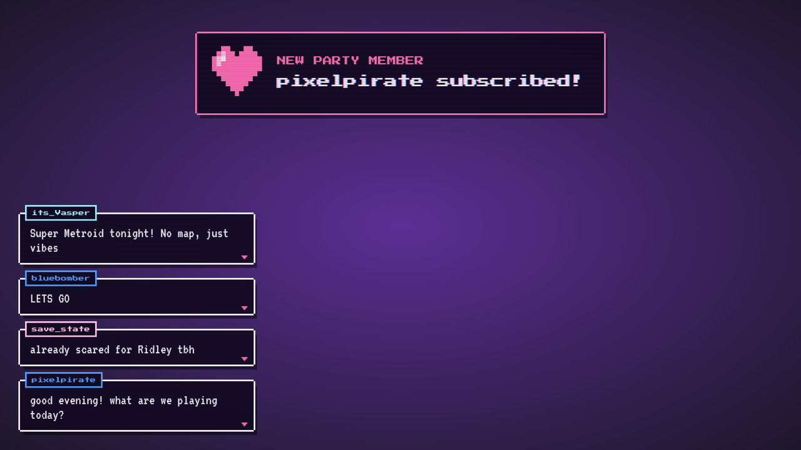

# its_Vasper overlays

SNES and CRT styled stream overlays for OBS, made for my Twitch channel [its_Vasper](https://www.twitch.tv/its_vasper).

Plain HTML, CSS and JavaScript. No build step, no framework, no account or token needed.



**[Live demo](https://irisdordio.github.io/vasper-overlays/)**

## What's inside

| Overlay | What it does |
| --- | --- |
| `overlays/scene.html` | Full-screen *starting soon*, *be right back* and *ending* scenes, each with its own motion (see below) |
| `overlays/chat.html` | Live Twitch chat as RPG dialogue boxes, with emotes and typewriter text |
| `overlays/alerts.html` | Sub, resub, gift sub, raid and cheer alerts with pixel icons and an 8-bit jingle |



## Using it in OBS

1. In OBS, add a **Browser** source.
2. Set the URL to one of the overlays (see options below), for example
   `https://irisdordio.github.io/vasper-overlays/overlays/chat.html?channel=its_vasper`
3. Set **Width 1920** and **Height 1080**.
4. For alerts, tick **Control audio via OBS** so the jingle goes through your mixer.

You can also download the repo and point the browser source to the local file with **Local file** ticked.

Opened in a normal browser, each overlay scales to fit the window and shows a **← Home** button back to the demo page. Neither happens inside OBS, so the button never shows on stream.

After updating the overlays, right-click the source in OBS and choose **Refresh cache of current page**, or the old version may keep playing.

## Options

Every option is a URL parameter, so one file covers many scenes.

### Scenes

| Parameter | Default | Example |
| --- | --- | --- |
| `mode` | `starting` | `starting`, `brb`, `ending` |
| `minutes` | `5` | Countdown length. `0` hides the timer |
| `start` | `stream` | When the `starting` countdown begins in OBS: `stream` waits for **Start Streaming**, `load` starts as soon as the page loads |
| `speed` | `1` | Background speed multiplier, from `0.25` to `4` |
| `title`, `subtitle` | per mode | `?title=Super%20Metroid%20night` |
| `handle` | none | Name tag in the top corner, off unless set, e.g. `?handle=its_Vasper` |
| `avatar` | none | Path or URL to a pixel avatar |

Each scene moves differently, so viewers can tell them apart at a glance:

| Scene | Motion |
| --- | --- |
| `starting` | Stripes rush left, sparkles rise, a loading bar fills with the countdown |
| `brb` | Stripes freeze and breathe, sparkles twinkle in place, the title pulses like a pause menu |
| `ending` | Stripes drift back the other way, sparkles fall, the title drops in letter by letter |

#### Starting countdown and OBS

Inside OBS, the `starting` countdown holds at its full length until you press **Start Streaming**, so viewers always get the whole countdown however long you spend setting up. It resets if you stop the stream, and if the browser source reloads mid-countdown it picks up where it was instead of starting over.

This relies on OBS telling the page when the stream starts. Keep the browser source's **Page permissions** at *Read access to OBS status information* (the default) or higher. Opened in a normal browser, where there is no stream to wait for, the countdown starts straight away. The `brb` countdown always starts when the scene appears.

### Chat

| Parameter | Default | Notes |
| --- | --- | --- |
| `channel` | `its_vasper` | Any Twitch channel |
| `max` | `4` | Messages on screen |
| `fade` | `45` | Seconds before a message leaves. `0` keeps it |
| `colors` | `palette` | `twitch` uses each viewer's own colour |
| `hide` | common bots | Comma-separated names to ignore |
| `typespeed` | `10` | Milliseconds per letter. `0` is instant |
| `side` | left | `right` moves the column |
| `demo` | off | `1` shows fake messages |

Messages starting with `!` are skipped, and messages deleted by moderators disappear from the overlay too.

### Alerts

| Parameter | Default | Notes |
| --- | --- | --- |
| `channel` | `its_vasper` | |
| `duration` | `7` | Seconds per alert |
| `sound` | `1` | `0` mutes the jingle |
| `volume` | `0.25` | `0` to `1` |
| `minbits` | `1` | Ignore smaller cheers |
| `test` | off | `1` loops through every alert type |

## How it works

The chat and alerts connect to Twitch chat anonymously over WebSocket (`shared/twitch-irc.js`). Twitch sends subs, gift subs, raids and cheers through chat, so no login is needed.

**Follows are not included**, because Twitch only sends them to authenticated apps. The alerts overlay listens for `window.postMessage({ vasperAlert: { type, user, ... } })`, so a tool like Streamer.bot can push follow events into it later.

Design notes:

- One `--px` unit (4px) drives borders, shadows and spacing, so everything snaps to the same pixel grid.
- Motion uses shared easing curves (`--ease-out`, `--ease-in`, `--ease-bounce`) and GPU-friendly `translate3d`, so it stays smooth at stream frame rates. The striped background loops over one exact pattern repeat, so there is no visible jump.
- Pixel icons are drawn from text maps onto a tiny canvas, and the jingle is generated with a square-wave oscillator. No image or audio files.
- Viewer text is always inserted with `textContent`, never as HTML.
- `prefers-reduced-motion` turns animations off.

## Structure

```
vasper-overlays/
├── index.html            demo page (GitHub Pages)
├── overlays/
│   ├── scene.html
│   ├── chat.html
│   └── alerts.html
├── shared/
│   ├── crt.css           palette, pixel box, scanlines
│   ├── fonts/            bundled pixel fonts + licences
│   ├── stage.js          fits the 1920x1080 stage, adds the Home button
│   └── twitch-irc.js     anonymous Twitch chat client
└── docs/                 README images
```

## Credits

Fonts: [Press Start 2P](https://fonts.google.com/specimen/Press+Start+2P) by CodeMan38 and [VT323](https://fonts.google.com/specimen/VT323) by Peter Hull, both under the SIL Open Font License. Latin subsets are bundled in `shared/fonts/` with their licence files, so the overlays make no requests to Google Fonts.

Design and code by Íris Dórdio. Released under the MIT License.
