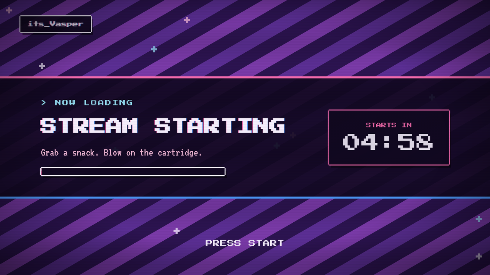
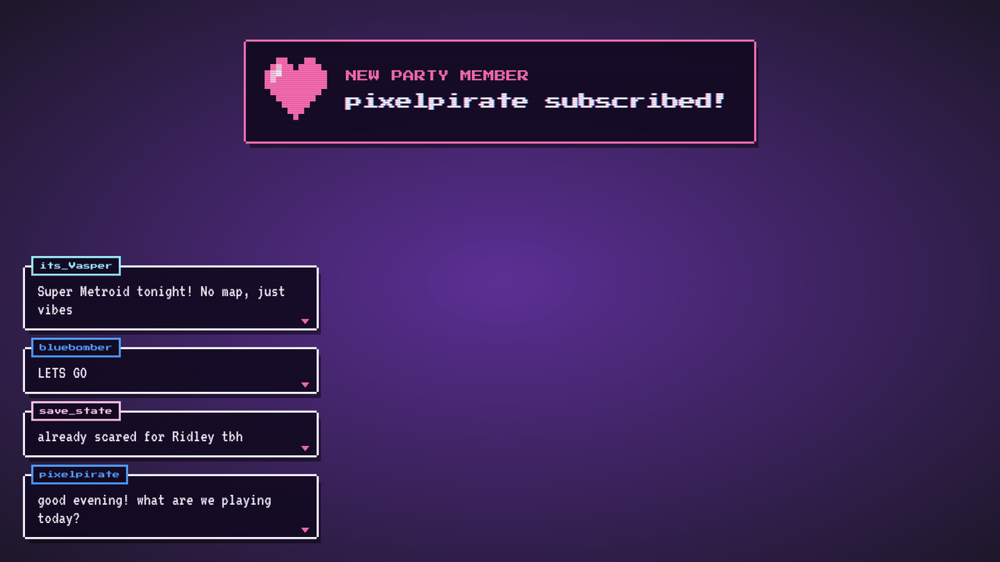

# its_Vasper overlays

SNES and CRT styled stream overlays for OBS, made for my Twitch channel [its_Vasper](https://www.twitch.tv/its_vasper).

Plain HTML, CSS and JavaScript. No build step, no framework, no account or token needed.



**[Live demo](https://irisdordio.github.io/vasper-overlays/)**

## What's inside

| Overlay | What it does |
| --- | --- |
| `overlays/scene.html` | Full-screen *starting soon*, *be right back* and *ending* scenes, each with its own motion (see below) |
| `overlays/chat.html` | Live Twitch chat as RPG dialogue boxes, with emotes and typewriter text |
| `overlays/alerts.html` | Sub, resub, gift sub, raid and cheer alerts with pixel icons and an 8-bit jingle |
| `overlays/frame.html` | Simple pixel border round the game with a CRT look |
| `overlays/avatar.html` | Pixel avatar that hops and opens its mouth while you talk (PNGtuber style) |
| `overlays/counter.html` | Attempt counter for challenge runs, controlled from chat by you and your mods |



## Using it in OBS

1. In OBS, add a **Browser** source.
2. Set the URL to one of the overlays (see options below), for example
   `https://irisdordio.github.io/vasper-overlays/overlays/chat.html?channel=its_vasper`
3. Set **Width 1920** and **Height 1080**.
4. For alerts, tick **Control audio via OBS** so the jingle goes through your mixer.

You can also download the repo and point the browser source to the local file with **Local file** ticked.

Opened in a normal browser, each overlay scales to fit the window and shows a **← Home** button back to the demo page. Neither happens inside OBS, so the button never shows on stream.

After updating the overlays, right-click the source in OBS and choose **Refresh cache of current page**, or the old version may keep playing.

## Options

Every option is a URL parameter, so one file covers many scenes.

### Scenes

| Parameter | Default | Example |
| --- | --- | --- |
| `mode` | `starting` | `starting`, `brb`, `ending` |
| `minutes` | `5` | Countdown length. `0` hides the timer |
| `start` | `stream` | When the `starting` countdown begins in OBS: `stream` waits for **Start Streaming**, `load` starts as soon as the page loads |
| `speed` | `1` | Background speed multiplier, from `0.25` to `4` |
| `title`, `subtitle` | per mode | `?title=Super%20Metroid%20night` |
| `handle` | `its_Vasper` | Credit line under PRESS START (`© 2026 its_Vasper`). `?handle=` (empty) hides it |
| `avatar` | none | Path or URL to a pixel avatar |

Each scene moves differently, so viewers can tell them apart at a glance:

| Scene | Motion |
| --- | --- |
| `starting` | Stripes rush left, sparkles rise, a loading bar fills with the countdown |
| `brb` | Stripes freeze and breathe, sparkles twinkle in place, the title pulses like a pause menu |
| `ending` | Stripes drift back the other way, sparkles fall, the title drops in letter by letter |

#### Starting countdown and OBS

Inside OBS, the `starting` countdown holds at its full length until you press **Start Streaming**, so viewers always get the whole countdown however long you spend setting up. It resets if you stop the stream, and if the browser source reloads mid-countdown it picks up where it was instead of starting over.

This relies on OBS telling the page when the stream starts. Keep the browser source's **Page permissions** at *Read access to OBS status information* (the default) or higher. Opened in a normal browser, where there is no stream to wait for, the countdown starts straight away. The `brb` countdown always starts when the scene appears.

### Chat

| Parameter | Default | Notes |
| --- | --- | --- |
| `channel` | `its_vasper` | Any Twitch channel |
| `max` | `4` | Messages on screen |
| `fade` | `45` | Seconds before a message leaves. `0` keeps it |
| `colors` | `palette` | `twitch` uses each viewer's own colour |
| `hide` | common bots | Comma-separated names to ignore |
| `typespeed` | `10` | Milliseconds per letter. `0` is instant |
| `side` | left | `right` moves the column |
| `demo` | off | `1` shows fake messages |

Messages starting with `!` are skipped, and messages deleted by moderators disappear from the overlay too.

### Alerts

| Parameter | Default | Notes |
| --- | --- | --- |
| `channel` | `its_vasper` | |
| `duration` | `7` | Seconds per alert |
| `sound` | `1` | `0` mutes the jingle |
| `volume` | `0.25` | `0` to `1` |
| `minbits` | `1` | Ignore smaller cheers |
| `test` | off | `1` loops through every alert type |

### Frame

A 48px pixel border round the game: plum with light CRT scanlines, vignette and flicker, a light pixel line with notched corners next to the game, and a few small pixel stars twinkling on the border.

| Parameter | Default | Notes |
| --- | --- | --- |
| `stars` | `16` | Number of pixel stars on the border, `0` to `40` |
| `crt` | border only | `full` also lays light scanlines over the game |
| `left`, `right`, `top`, `bottom` | `48` | Border thickness per side in px, to line the window up with a capture already placed in OBS. Overrides `aspect` on that side |
| `aspect` | none | Shape of the game window for captures that are not 16:9, e.g. `16:10` or `4:3`. The border stays 48px on the short sides and widens on the other two |

In OBS, put the frame source above the game capture, then right-click the game capture, choose **Transform → Edit Transform** and set **Position** to `48, 27` and **Size** to `1824 x 1026` (bounding box off). The border trims about 21px off the top and bottom of the game.

For a game that is not 16:9, add `aspect` to the frame URL and fit the capture with a bounding box. For `?aspect=16:10`: **Position** `172, 48`, **Bounding Box Type** *Scale to inner bounds*, **Bounding Box Size** `1576 x 984`, **Alignment in Bounding Box** *Center*. Opened in a browser, the frame logs the window size and position for any `aspect` to the console.

### Avatar

A pixel portrait in a small striped window with a name tag. It breathes while you are quiet and hops, with sound pixels on both sides, while you talk. Without your own art it shows a built-in placeholder face.

The voice level comes from OBS itself through **obs-websocket**, which ships with OBS 28 and later, so the browser source never asks for microphone access:

1. In OBS, open **Tools → WebSocket Server Settings**, tick **Enable WebSocket server** and set a password.
2. Add a Browser source with `overlays/avatar.html?password=YOUR_PASSWORD`, Width 1920, Height 1080.
3. Talk: the avatar follows the **Mic/Aux** meter. If your mic has another name in the Audio Mixer, add `&mic=Name`.

The password stays on your computer (the page only talks to `127.0.0.1`), but don't show the source's properties on stream. A muted mic shows no level, so the avatar stays still. Opened in a normal browser, the page uses that browser's microphone instead.

| Parameter | Default | Notes |
| --- | --- | --- |
| `password` | none | obs-websocket password |
| `port` | `4455` | obs-websocket port |
| `mic` | `Mic/Aux` | Name of the audio source to follow, as shown in the Audio Mixer |
| `threshold` | `-35` | Level in dB that counts as talking. Raise it (e.g. `-25`) if background noise triggers it |
| `hold` | `220` | Milliseconds to stay in the talking pose after you stop |
| `idle`, `talk`, `blink` | built-in | Paths or URLs to your own frames: mouth closed, mouth open and eyes closed. Only `idle` is required |
| `name` | `its_Vasper` | Name tag. `?name=` (empty) hides it |
| `corner` | `bl` | `bl`, `br`, `tl` or `tr` |
| `size` | `192` | Portrait size in px, `96` to `480` |
| `gap` | `64` | Distance from the edges of the screen in px |
| `demo` | off | `1` fakes talking, for testing the look |

### Attempt counter

A small box in a corner of the game that counts failed attempts at one goal, such as a Shiyu Defense floor or a Deadly Assault boss. Made for challenge series like *Element Lock: A-Rank Only*.

You and your moderators control it from Twitch chat, so you never leave the game:

| Command | What it does |
| --- | --- |
| `!fail` | Adds one attempt |
| `!unfail` | Takes one away, for mistakes |
| `!clear` | Shows *CLEARED! in N attempts* (the winning try counts too), then goes back to 0 |
| `!reset` | Back to 0 without the banner |
| `!setfail 12` | Sets an exact number |

Everyone else's commands are ignored. `!fail` has a short cooldown, so if you and a mod type it at the same time it only counts once. The count is saved for each goal, so it survives an OBS restart or a refreshed source.

In a normal browser, or in OBS through **Interact** on the source, the keys `+`, `-`, `C` and `0` do the same.

Example URL:

```
overlays/counter.html?element=physical&goal=Shiyu%20Defense&note=A-Rank%20only%20%C2%B7%20no%20swaps
```

| Parameter | Default | Notes |
| --- | --- | --- |
| `channel` | `its_vasper` | Channel whose chat controls the counter |
| `element` | none | `physical`, `electric`, `fire`, `ice` or `ether`. Sets the accent colour and the top line |
| `goal` | none | What you are trying to beat, shown on the top line. Each goal keeps its own count |
| `label` | `ATTEMPTS` | Big word above the rules line |
| `note` | none | Short line under the label, e.g. the challenge rules |
| `start` | saved count | Forces a starting number |
| `corner` | `tr` | `tr`, `tl`, `br` or `bl` |
| `gap` | `72` | Distance from the edges of the screen in px. `72` sits just inside the frame overlay |
| `mods` | `1` | `0` lets only you control it |
| `allow` | none | Extra usernames that may control it, comma-separated |
| `cooldown` | `3` | Seconds between two `!fail` counts |
| `clearsecs` | `8` | How long the CLEARED banner stays |
| `demo` | off | `1` fails a few times and clears, on a loop. Never touches the saved count |

## How it works

The chat and alerts connect to Twitch chat anonymously over WebSocket (`shared/twitch-irc.js`). Twitch sends subs, gift subs, raids and cheers through chat, so no login is needed.

**Follows are not included**, because Twitch only sends them to authenticated apps. The alerts overlay listens for `window.postMessage({ vasperAlert: { type, user, ... } })`, so a tool like Streamer.bot can push follow events into it later.

Design notes:

- One `--px` unit (4px) drives borders, shadows and spacing, so everything snaps to the same pixel grid.
- Motion uses shared easing curves (`--ease-out`, `--ease-in`, `--ease-bounce`) and GPU-friendly `translate3d`, so it stays smooth at stream frame rates. The striped background loops over one exact pattern repeat, so there is no visible jump.
- Pixel icons are drawn from text maps onto a tiny canvas, and the jingle is generated with a square-wave oscillator. No image or audio files.
- Viewer text is always inserted with `textContent`, never as HTML.
- `prefers-reduced-motion` turns animations off.

## Structure

```
vasper-overlays/
├── index.html            demo page (GitHub Pages)
├── overlays/
│   ├── scene.html
│   ├── chat.html
│   ├── alerts.html
│   ├── frame.html
│   ├── avatar.html
│   └── counter.html
├── shared/
│   ├── crt.css           palette, pixel box, scanlines
│   ├── fonts/            bundled pixel fonts + licences
│   ├── stage.js          fits the 1920x1080 stage, adds the Home button
│   └── twitch-irc.js     anonymous Twitch chat client
└── docs/                 README images
```

## Credits

Fonts: [Press Start 2P](https://fonts.google.com/specimen/Press+Start+2P) by CodeMan38 and [VT323](https://fonts.google.com/specimen/VT323) by Peter Hull, both under the SIL Open Font License. Latin subsets are bundled in `shared/fonts/` with their licence files, so the overlays make no requests to Google Fonts.

Design and code by Íris Dórdio. Released under the MIT License.
